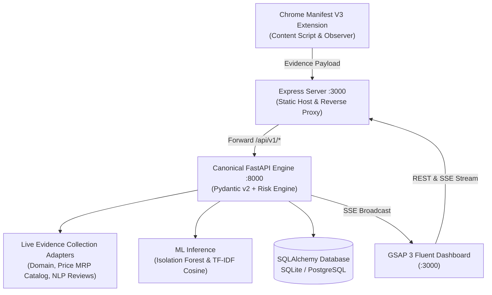

# WebGuard: Real-Time E-Commerce Fraud-Risk Assessment Platform

> **Explainable Multi-Factor Cybersecurity & Pre-Payment Advisory Protection**

WebGuard is a production-grade cybersecurity platform engineered to evaluate online shopping storefronts **before** a consumer enters payment credentials or transfers funds.

Unlike static blocklists (which fail against newly registered domains and zero-day scams), WebGuard evaluates **seven operational fraud factors** using an evidence-backed scoring engine coupled with genuine **Machine Learning (Scikit-Learn Isolation Forest & NLP TF-IDF Cosine Similarity)** to produce an explainable, auditable risk score.

---

## 🏛️ System Architecture: Single Canonical Source of Truth



1. **Canonical Backend (FastAPI + Pydantic v2 + SQLAlchemy):** Single source of truth for all risk calculations, factor decomposition, and transactional audit persistence.
2. **Reverse Proxy (Node.js Express):** Serves static frontend assets and transparently proxies `/api/v1/*` to `http://127.0.0.1:8000`, eliminating duplicate analysis engines and divergent scores.
3. **Live Evidence Adapters:** Modular adapters collect domain intelligence (DNS, TLS certificate state via safe sockets, registrar age, typosquatting), market price comparisons, and customer reviews.
4. **Machine Learning:** 
   - **Isolation Forest:** Trains on retail discount distributions to detect anomalous price drops.
   - **NLP TF-IDF & Cosine Similarity:** Computes pairwise similarity matrices to detect duplicate fake reviews and repetitive phrases.
5. **SSRF & Network Defense:** Complete protection blocking loopback (`127.0.0.1`, `::1`), RFC1918 private CIDRs (`10.0.0.0/8`, `172.16.0.0/12`, `192.168.0.0/16`), and link-local cloud metadata (`169.254.169.254`).
6. **Pre-Payment Interception:** Manifest V3 browser extension with debounced `MutationObserver`, least-privilege host permissions, and an advisory security overlay on checkout actions.
7. **Real-Time SOC Dashboard:** Ultra-fluent Vanilla TypeScript + GSAP 3 interface listening to Server-Sent Events (`/api/v1/events`).

---

## 📊 Seven Operational Fraud Factors (100% Weight Sum)

| Risk Factor | Weight | Detection Methodology |
| :--- | :---: | :--- |
| **Domain Credibility** | **20%** | Domain age (<14 days critical), high-abuse TLDs (`.top`, `.shop`, `.xyz`), typosquatting / l33tspeak brand mimicry, TLS certificate validity. |
| **Price Anomaly** | **20%** | Statistical deviation from authenticated retail MRP, discount percentage, and **Isolation Forest ML** anomaly detection. |
| **Review Patterns** | **15%** | **TF-IDF Vectorization** + pairwise **Cosine Similarity**, duplicate review detection, repetitive n-gram phrasing, sample size disclosure. |
| **Website Identity** | **15%** | Verification of corporate domain email (flagging free webmail like Gmail/Proton), phone line presence, physical business address. |
| **Refund Policy** | **10%** | Detection of missing return policy, vague timelines, or strict "all sales final / no refund" clauses. |
| **Payment Methods** | **10%** | Detection of prepaid-only enforcement, unverified personal UPI VPAs, cryptocurrency/wire traps, absence of buyer-protected gateways. |
| **Site Behaviour** | **10%** | Hidden DOM elements, suspicious cross-domain checkout redirections, psychological urgency countdown banners. |
| **Total Weight** | **100%** | **Strictly Normalized Additive Risk Score (0 - 100)** |

### Centralized Risk Thresholds
- **0 - 29 (`LOW`):** Normal storefront indicators. Safe to proceed.
- **30 - 59 (`MEDIUM`):** Elevated risk signals. Exercise caution.
- **60 - 79 (`HIGH`):** Strong deception indicators. Pre-payment warning triggered.
- **80 - 100 (`CRITICAL`):** Blatant fraud indicators. Immediate pre-payment intercept.

---

## 📁 Repository Structure

```
WebGuard/
├── backend/
│   ├── app/
│   │   ├── adapters/          # Domain, price, and review evidence collection adapters
│   │   ├── analyzers/         # 7 operational factor analyzers
│   │   ├── api/               # FastAPI routers (/analyze, /history, /health, /events)
│   │   ├── engine/            # Canonical risk engine & centralized thresholds
│   │   ├── ml/                # Scikit-Learn Isolation Forest & NLP TF-IDF models
│   │   ├── models/            # SQLAlchemy ORM models & Pydantic v2 schemas
│   │   └── utils/             # SSRF network defense & domain parsing / typosquatting
│   ├── tests/                 # 28 automated pytest test suites
│   ├── Dockerfile             # Containerized backend deployment
│   ├── requirements.txt       # Python dependencies
│   └── server.ts              # Express static host & transparent reverse proxy
├── frontend/
│   ├── src/
│   │   ├── app.ts             # GSAP 3 animated risk gauge, SSE listener, history UI
│   │   └── style.css          # Modern dark-mode glassmorphic styling
│   ├── index.html             # Dashboard markup
│   └── vite.config.ts         # Vite build configuration
├── extension/
│   ├── src/
│   │   ├── content/           # Safe DOM extractor & pre-payment warning overlay
│   │   ├── background/        # Manifest V3 service worker & badge manager
│   │   └── popup/             # Extension popup view
│   ├── build.js               # esbuild compilation script
│   └── manifest.json          # Chrome Manifest V3 declaration
└── docs/
    ├── ARCHITECTURE.md        # Complete system architecture specification
    ├── API_REFERENCE.md       # Versioned REST & SSE API documentation
    └── TESTING_CHECKLIST.md   # Automated & manual testing verification checklist
```

---

## 🚀 Getting Started

### 1. Prerequisites
- **Node.js** (v18+)
- **Python** (v3.10+)

### 2. Setup & Installation
```bash
# Clone the repository
git clone https://github.com/DhangarRohit18/EH_CP.git
cd EH_CP

# Install Node dependencies
npm install

# Install Python backend dependencies
pip install -r backend/requirements.txt
```

### 3. Running the Canonical Backend (FastAPI)
```bash
python -m uvicorn app.main:app --app-dir backend --port 8000 --reload
```
- API health check: `http://127.0.0.1:8000/api/v1/health`
- Interactive OpenAPI docs: `http://127.0.0.1:8000/docs`

### 4. Running the Frontend Dashboard & Proxy
In a second terminal window:
```bash
npm run dev
```
- Open `http://localhost:3000` in your browser.
- The dashboard automatically connects to the FastAPI backend via the Express proxy and subscribes to the live SSE stream at `/api/v1/events`.

### 5. Building the Browser Extension
```bash
npm run build:extension
```
- Assets are compiled to `extension/dist/`.
- Open Chrome or Edge and visit `chrome://extensions/`.
- Enable **Developer mode** (top right).
- Click **Load unpacked** and select the `extension/` directory.

---

## 🧪 Automated Testing (100% Pass Rate)

Run the full automated test suite with pytest:
```bash
cd backend
python -m pytest tests -v
```

All 28 tests pass across 5 comprehensive test suites:
- `tests/test_api_and_db.py`: Health check, persistence, history filtering/pagination, transactional deletion.
- `tests/test_ml_models.py`: Isolation Forest anomaly detection, rule fallback, NLP TF-IDF cosine similarity, duplicate detection.
- `tests/test_risk_engine.py`: Weight totals, threshold bounds, determinism, missing evidence handling, zero hardcoded hacks.
- `tests/test_security_ssrf.py`: SSRF defenses, loopback/localhost blocking, cloud metadata blocking, private RFC1918 blocking.
- `tests/test_storefront_fixtures.py`: 6 controlled storefront fixtures (legitimate store, scam store, missing metadata, circuit breaker timeout, dynamic checkout intercept, brand typosquatting).

---

## 🔒 Privacy & Security Standards

- **Zero Credential Inspection:** Passwords, credit/debit card numbers, CVVs, OTPs, and session cookies are never queried, logged, or transmitted.
- **SSRF Defense:** All external URL fetches validate DNS resolution at every hop and strictly block private/loopback/cloud-metadata CIDRs.
- **Circuit Breakers:** External intelligence adapters feature automated failure thresholds and timeouts to prevent cascading latency.
- **Content Security Policy:** Extension enforces strict CSP preventing dynamic code injection or untrusted DOM execution.
